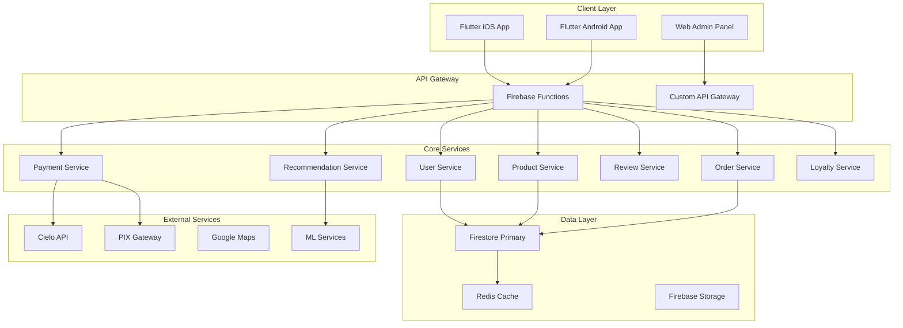

# 🏗️ **Plano de Arquitetura - 4youpet 2024**
## Análise da Arquitetura Atual e Plano de Ação

**Versão:** 1.0  
**Data:** Dezembro 2024  
**Autor:** Solution Architect  
**Status:** Draft

---

## 📊 **1. ANÁLISE DA ARQUITETURA ATUAL**

### 1.1 Stack Tecnológico Atual
```
Frontend: Flutter (iOS/Android)
├── State Management: Provider + Riverpod
├── UI: Material Design + Custom Components
├── Navigation: Navigator 2.0
└── Local Storage: SharedPreferences + Secure Storage

Backend: Firebase Ecosystem
├── Database: Firestore (NoSQL)
├── Authentication: Firebase Auth
├── Functions: Cloud Functions (Node.js)
├── Storage: Firebase Storage
├── Messaging: FCM
└── Analytics: Firebase Analytics

Integrações Externas:
├── Pagamentos: Cielo API
├── Maps: Google Maps API
├── Geolocalização: Geolocator
└── Notificações: FCM
```

### 1.2 Estrutura de Dados Atual
```typescript
// Principais Coleções Firestore
users/
├── {userId}/
│   ├── profile: UserProfile
│   ├── pets: Pet[]
│   ├── addresses: Address[]
│   └── orders: Order[]

products/
├── {productId}/
│   ├── basicInfo: ProductInfo
│   ├── images: string[]
│   ├── sizes: ItemSize[]
│   └── keywords: string[]

companys/
├── {companyId}/
│   ├── profile: CompanyProfile
│   ├── services: Service[]
│   ├── address: Address
│   └── subscription: Subscription

orders/
├── {orderId}/
│   ├── items: OrderItem[]
│   ├── status: OrderStatus
│   ├── payment: PaymentInfo
│   └── tracking: TrackingInfo
```

### 1.3 Pontos Fortes da Arquitetura Atual
- ✅ **Escalabilidade:** Firebase suporta crescimento automático
- ✅ **Real-time:** Firestore + FCM para updates em tempo real
- ✅ **Segurança:** Firebase Auth + Security Rules
- ✅ **Cross-platform:** Flutter para iOS/Android
- ✅ **Modularidade:** Provider pattern bem implementado

### 1.4 Limitações Identificadas
- ❌ **Performance:** Queries complexas podem ser lentas
- ❌ **Offline:** Funcionalidade limitada
- ❌ **Analytics:** Dados limitados para insights
- ❌ **ML/AI:** Sem capacidades de machine learning
- ❌ **Caching:** Estratégia de cache básica

---

## 🎯 **2. GAPS ARQUITETURAIS PARA NOVAS FEATURES**

### 2.1 Sistema de Avaliações
**Gap:** Falta estrutura para reviews e ratings
```typescript
// Nova Estrutura Necessária
reviews/
├── {reviewId}/
│   ├── productId: string
│   ├── userId: string
│   ├── rating: number (1-5)
│   ├── comment: string
│   ├── images: string[]
│   ├── helpful: number
│   ├── verified: boolean
│   └── createdAt: Timestamp

// Agregações necessárias
productStats/
├── {productId}/
│   ├── averageRating: number
│   ├── totalReviews: number
│   ├── ratingDistribution: {1: number, 2: number, ...}
│   └── lastUpdated: Timestamp
```

### 2.2 Sistema PIX
**Gap:** Falta integração com gateway PIX
```typescript
// Nova Estrutura de Pagamento
payments/
├── {paymentId}/
│   ├── orderId: string
│   ├── method: 'credit_card' | 'pix'
│   ├── pixData?: {
│   │   ├── qrCode: string
│   │   ├── copyPasteCode: string
│   │   └── expiresAt: Timestamp
│   ├── status: PaymentStatus
│   └── processedAt: Timestamp
```

### 2.3 Sistema de Recomendações (IA)
**Gap:** Falta infraestrutura de ML
```typescript
// Estrutura para ML
userBehavior/
├── {userId}/
│   ├── views: ProductView[]
│   ├── purchases: Purchase[]
│   ├── searches: SearchQuery[]
│   └── preferences: UserPreferences

recommendations/
├── {userId}/
│   ├── productRecommendations: string[]
│   ├── similarUsers: string[]
│   ├── lastCalculated: Timestamp
│   └── algorithm: string
```

### 2.4 Programa de Fidelidade
**Gap:** Falta sistema de pontos e níveis
```typescript
// Sistema de Fidelidade
loyalty/
├── {userId}/
│   ├── points: number
│   ├── level: 'bronze' | 'silver' | 'gold' | 'platinum'
│   ├── totalSpent: number
│   ├── transactions: LoyaltyTransaction[]
│   └── benefits: Benefit[]

loyaltyTransactions/
├── {transactionId}/
│   ├── userId: string
│   ├── type: 'earn' | 'redeem'
│   ├── points: number
│   ├── orderId?: string
│   └── createdAt: Timestamp
```

---

## 🏗️ **3. NOVA ARQUITETURA PROPOSTA**

### 3.1 Arquitetura de Alto Nível


### 3.2 Estrutura de Microserviços
```typescript
// services/
├── user-service/
│   ├── handlers/
│   ├── models/
│   ├── repositories/
│   └── index.ts
├── product-service/
│   ├── handlers/
│   ├── models/
│   ├── repositories/
│   └── index.ts
├── review-service/
│   ├── handlers/
│   ├── models/
│   ├── repositories/
│   └── index.ts
├── recommendation-service/
│   ├── handlers/
│   ├── ml/
│   ├── models/
│   └── index.ts
└── loyalty-service/
    ├── handlers/
    ├── models/
    ├── repositories/
    └── index.ts
```

---

## 🔧 **4. COMPONENTES NOVOS NECESSÁRIOS**

### 4.1 Backend Components

#### 4.1.1 Review Service
```typescript
// functions/src/review-service.ts
export const createReview = onCall(async (request) => {
  // Validação de usuário autenticado
  // Criação de review
  // Atualização de estatísticas do produto
  // Notificação para empresa
});

export const getProductReviews = onCall(async (request) => {
  // Busca reviews com paginação
  // Filtros por rating
  // Ordenação por relevância
});

export const updateProductStats = onDocumentCreated(
  "reviews/{reviewId}",
  async (event) => {
    // Recalcula estatísticas do produto
    // Atualiza cache
  }
);
```

#### 4.1.2 Payment Service (PIX)
```typescript
// functions/src/payment-service.ts
export const createPixPayment = onCall(async (request) => {
  // Integração com gateway PIX
  // Geração de QR Code
  // Webhook para confirmação
});

export const confirmPixPayment = onRequest(async (req, res) => {
  // Webhook do gateway PIX
  // Atualização de status do pedido
  // Notificação para usuário
});
```

#### 4.1.3 Recommendation Service
```typescript
// functions/src/recommendation-service.ts
export const generateRecommendations = onCall(async (request) => {
  // Algoritmo de recomendação
  // Baseado em histórico de compras
  // Produtos similares
  // Usuários similares
});

export const trackUserBehavior = onCall(async (request) => {
  // Tracking de visualizações
  // Tracking de buscas
  // Atualização de perfil de usuário
});
```

### 4.2 Frontend Components

#### 4.2.1 Review System
```dart
// lib/features/reviews/
├── models/
│   ├── review.dart
│   ├── product_stats.dart
│   └── review_filter.dart
├── services/
│   ├── review_service.dart
│   └── review_repository.dart
├── widgets/
│   ├── review_card.dart
│   ├── rating_widget.dart
│   ├── review_form.dart
│   └── product_rating_summary.dart
└── screens/
    ├── product_reviews_screen.dart
    └── my_reviews_screen.dart
```

#### 4.2.2 PIX Payment
```dart
// lib/features/payments/
├── models/
│   ├── pix_payment.dart
│   └── payment_method.dart
├── services/
│   ├── pix_service.dart
│   └── payment_gateway.dart
├── widgets/
│   ├── pix_qr_code.dart
│   ├── pix_copy_code.dart
│   └── payment_status.dart
└── screens/
    └── pix_payment_screen.dart
```

#### 4.2.3 Recommendation Engine
```dart
// lib/features/recommendations/
├── models/
│   ├── recommendation.dart
│   └── user_preference.dart
├── services/
│   ├── recommendation_service.dart
│   └── behavior_tracker.dart
├── widgets/
│   ├── recommendation_card.dart
│   ├── similar_products.dart
│   └── personalized_section.dart
└── screens/
    └── recommendations_screen.dart
```

---

## 📋 **5. PLANO DE MIGRAÇÃO E IMPLEMENTAÇÃO**

### 5.1 Fase 1: Fundação (Q1 2025) - 8 semanas

#### Sprint 1-2: Review System Backend
**Objetivo:** Implementar sistema de avaliações
- [ ] Criar coleções Firestore para reviews
- [ ] Implementar Cloud Functions para reviews
- [ ] Configurar Security Rules
- [ ] Implementar agregações de estatísticas
- [ ] Testes unitários e integração

**Entregáveis:**
- Review Service completo
- API endpoints funcionais
- Documentação técnica

#### Sprint 3-4: PIX Integration
**Objetivo:** Integrar pagamento PIX
- [ ] Escolher gateway PIX (PagSeguro/Mercado Pago)
- [ ] Implementar Payment Service
- [ ] Configurar webhooks
- [ ] Testes de integração
- [ ] Documentação de API

**Entregáveis:**
- PIX Service funcional
- Webhooks configurados
- Testes de pagamento

#### Sprint 5-6: Review System Frontend
**Objetivo:** Interface de avaliações
- [ ] Criar widgets de review
- [ ] Implementar formulário de avaliação
- [ ] Tela de listagem de reviews
- [ ] Integração com backend
- [ ] Testes de usabilidade

**Entregáveis:**
- UI/UX de reviews completa
- Integração com backend
- Testes de aceitação

#### Sprint 7-8: PIX Frontend + Tracking
**Objetivo:** Interface PIX e rastreamento
- [ ] Tela de pagamento PIX
- [ ] QR Code e código copia/cola
- [ ] Sistema de rastreamento
- [ ] Notificações de status
- [ ] Testes end-to-end

**Entregáveis:**
- PIX UI completa
- Sistema de tracking
- App funcional com novas features

### 5.2 Fase 2: Diferenciação (Q2 2025) - 8 semanas

#### Sprint 9-10: Recommendation Engine
**Objetivo:** Sistema de recomendações
- [ ] Implementar algoritmo de recomendação
- [ ] Tracking de comportamento do usuário
- [ ] Cache de recomendações
- [ ] Testes de performance
- [ ] Otimização de queries

#### Sprint 11-12: Loyalty Program
**Objetivo:** Programa de fidelidade
- [ ] Sistema de pontos
- [ ] Níveis de usuário
- [ ] Benefícios e recompensas
- [ ] Dashboard de fidelidade
- [ ] Gamificação

#### Sprint 13-14: Advanced Search
**Objetivo:** Busca avançada
- [ ] Busca por voz
- [ ] Busca por imagem
- [ ] Filtros avançados
- [ ] Sugestões inteligentes
- [ ] Performance otimizada

#### Sprint 15-16: Testing & Optimization
**Objetivo:** Testes e otimização
- [ ] Testes de carga
- [ ] Otimização de performance
- [ ] Monitoramento
- [ ] Documentação final
- [ ] Deploy em produção

---

## 🛠️ **6. REQUISITOS TÉCNICOS E DEPENDÊNCIAS**

### 6.1 Novas Dependências Flutter
```yaml
dependencies:
  # PIX Integration
  qr_code_scanner: ^1.0.1
  qr_flutter: ^4.1.0
  
  # ML/AI
  tflite_flutter: ^0.10.4
  camera: ^0.10.5+5
  speech_to_text: ^6.6.0
  
  # Caching
  hive: ^2.2.3
  hive_flutter: ^1.1.0
  
  # Analytics
  mixpanel_flutter: ^2.0.0
  
  # Image Processing
  image: ^4.1.3
  cached_network_image: ^3.3.0
```

### 6.2 Novas Dependências Backend
```json
{
  "dependencies": {
    "axios": "^1.6.0",
    "redis": "^4.6.0",
    "tensorflow": "^4.10.0",
    "sharp": "^0.32.0",
    "node-cron": "^3.0.0"
  }
}
```

### 6.3 Configurações Firebase
```typescript
// firebase.json
{
  "firestore": {
    "rules": "firestore.rules",
    "indexes": "firestore.indexes.json"
  },
  "functions": {
    "source": "functions",
    "runtime": "nodejs18",
    "memory": "256MB"
  },
  "storage": {
    "rules": "storage.rules"
  }
}
```

### 6.4 Security Rules Atualizadas
```javascript
// firestore.rules
rules_version = '2';
service cloud.firestore {
  match /databases/{database}/documents {
    // Reviews
    match /reviews/{reviewId} {
      allow read: if true;
      allow create: if request.auth != null && 
        request.auth.uid == resource.data.userId;
      allow update: if request.auth != null && 
        request.auth.uid == resource.data.userId;
    }
    
    // Product Stats
    match /productStats/{productId} {
      allow read: if true;
      allow write: if false; // Only via Cloud Functions
    }
    
    // Loyalty
    match /loyalty/{userId} {
      allow read, write: if request.auth != null && 
        request.auth.uid == userId;
    }
  }
}
```

---

## 📊 **7. MONITORAMENTO E OBSERVABILIDADE**

### 7.1 Métricas Técnicas
```typescript
// monitoring/metrics.ts
export const metrics = {
  // Performance
  apiResponseTime: 'histogram',
  databaseQueryTime: 'histogram',
  cacheHitRate: 'gauge',
  
  // Business
  reviewCreationRate: 'counter',
  pixPaymentSuccessRate: 'gauge',
  recommendationClickRate: 'gauge',
  
  // Errors
  apiErrorRate: 'counter',
  paymentFailureRate: 'counter',
  recommendationErrorRate: 'counter'
};
```

### 7.2 Alertas Configurados
- **API Response Time > 2s**
- **Error Rate > 5%**
- **PIX Payment Failure > 10%**
- **Database Connection Issues**
- **Memory Usage > 80%**

### 7.3 Dashboards
- **Business Metrics:** GMV, Conversion, Retention
- **Technical Metrics:** Performance, Errors, Uptime
- **User Behavior:** Reviews, Recommendations, Loyalty

---

## 💰 **8. ANÁLISE DE CUSTOS**

### 8.1 Custos de Infraestrutura
```
Firebase Firestore:
- Atual: $50/mês
- Projetado: $200/mês (+300% dados)

Firebase Functions:
- Atual: $30/mês
- Projetado: $120/mês (+4x execuções)

Firebase Storage:
- Atual: $20/mês
- Projetado: $80/mês (+imagens reviews)

Redis Cache:
- Novo: $50/mês

Total Mensal: $450/mês (+$350/mês)
```

### 8.2 Custos de Desenvolvimento
```
Backend Development: 3 devs × 6 meses = R$ 180K
Frontend Development: 2 devs × 6 meses = R$ 120K
DevOps/Infrastructure: 1 dev × 3 meses = R$ 30K
Testing/QA: 1 tester × 6 meses = R$ 40K

Total Desenvolvimento: R$ 370K
```

### 8.3 ROI Projetado
```
Investimento Total: R$ 370K + R$ 4.2K/mês
Receita Adicional: R$ 4M/ano
ROI: 1,080% em 12 meses
Payback: 3.5 meses
```

---

## ⚠️ **9. RISCOS E MITIGAÇÕES**

### 9.1 Riscos Técnicos
| Risco | Probabilidade | Impacto | Mitigação |
|-------|---------------|---------|-----------|
| Performance degradation | Alta | Alto | Cache Redis, otimização queries |
| PIX integration issues | Média | Alto | Testes extensivos, fallback |
| ML model accuracy | Média | Médio | A/B testing, feedback loop |
| Data migration errors | Baixa | Alto | Backup, rollback plan |

### 9.2 Riscos de Negócio
| Risco | Probabilidade | Impacto | Mitigação |
|-------|---------------|---------|-----------|
| Low adoption of reviews | Média | Alto | Incentivos, UX otimizada |
| PIX payment failures | Baixa | Alto | Monitoramento, suporte |
| Competition response | Alta | Médio | Diferenciação, velocidade |
| Regulatory changes | Baixa | Alto | Compliance, legal review |

---

## 📅 **10. CRONOGRAMA DETALHADO**

### Q1 2025 - Fundação
```
Janeiro:
├── Semana 1-2: Review System Backend
├── Semana 3-4: PIX Integration Backend
└── Semana 5: Testing & Documentation

Fevereiro:
├── Semana 1-2: Review System Frontend
├── Semana 3-4: PIX Frontend + Tracking
└── Semana 5: Integration Testing

Março:
├── Semana 1-2: End-to-End Testing
├── Semana 3-4: Performance Optimization
└── Semana 5: Production Deployment
```

### Q2 2025 - Diferenciação
```
Abril:
├── Semana 1-2: Recommendation Engine
├── Semana 3-4: Loyalty Program Backend
└── Semana 5: Testing

Maio:
├── Semana 1-2: Loyalty Program Frontend
├── Semana 3-4: Advanced Search
└── Semana 5: Integration

Junho:
├── Semana 1-2: Testing & Optimization
├── Semana 3-4: Performance Tuning
└── Semana 5: Production Release
```

---

## 🎯 **11. CRITÉRIOS DE SUCESSO TÉCNICO**

### 11.1 Performance
- ✅ **API Response Time:** < 500ms (95th percentile)
- ✅ **App Load Time:** < 3s
- ✅ **Database Query Time:** < 200ms
- ✅ **Cache Hit Rate:** > 80%

### 11.2 Reliability
- ✅ **Uptime:** 99.9%
- ✅ **Error Rate:** < 0.1%
- ✅ **Data Consistency:** 100%
- ✅ **Backup Success:** 100%

### 11.3 Security
- ✅ **Authentication:** 100% requests authenticated
- ✅ **Data Encryption:** All sensitive data encrypted
- ✅ **Access Control:** Proper RBAC implementation
- ✅ **Audit Logging:** Complete audit trail

---

## 📞 **12. EQUIPE E RESPONSABILIDADES**

### 12.1 Core Team
- **Solution Architect:** [Nome] - Arquitetura geral
- **Backend Lead:** [Nome] - Cloud Functions, APIs
- **Frontend Lead:** [Nome] - Flutter, UI/UX
- **DevOps Engineer:** [Nome] - Infraestrutura, CI/CD
- **QA Lead:** [Nome] - Testes, qualidade

### 12.2 Stakeholders
- **Product Manager:** Priorização, requisitos
- **CTO:** Aprovação técnica
- **CEO:** Aprovação estratégica
- **Head of Marketing:** Go-to-market

---

**Documento aprovado em:** [Data]  
**Próxima revisão:** [Data + 30 dias]  
**Versão:** 1.0

---

## 📋 **CHECKLIST DE IMPLEMENTAÇÃO**

### Backend (Firebase Functions)
- [ ] Review Service implementado
- [ ] PIX Payment Service implementado
- [ ] Recommendation Service implementado
- [ ] Loyalty Service implementado
- [ ] Security Rules atualizadas
- [ ] Monitoring configurado
- [ ] Testes unitários completos
- [ ] Documentação técnica

### Frontend (Flutter)
- [ ] Review UI/UX implementada
- [ ] PIX Payment UI implementada
- [ ] Recommendation UI implementada
- [ ] Loyalty UI implementada
- [ ] Advanced Search UI implementada
- [ ] Testes de integração
- [ ] Testes de usabilidade
- [ ] Performance otimizada

### Infrastructure
- [ ] Redis Cache configurado
- [ ] CDN configurado
- [ ] Monitoring dashboards
- [ ] Alertas configurados
- [ ] Backup strategy
- [ ] Disaster recovery plan
- [ ] Security audit
- [ ] Performance testing
